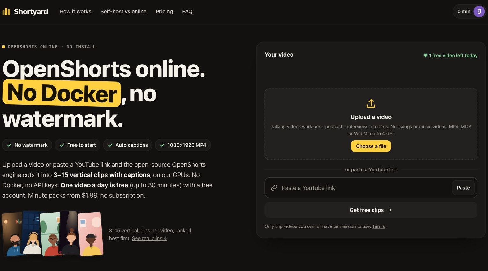
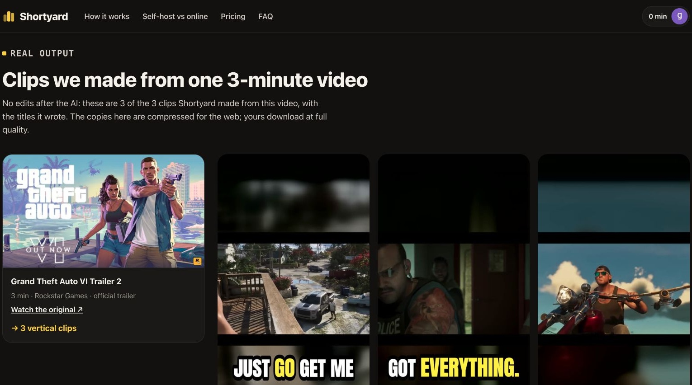
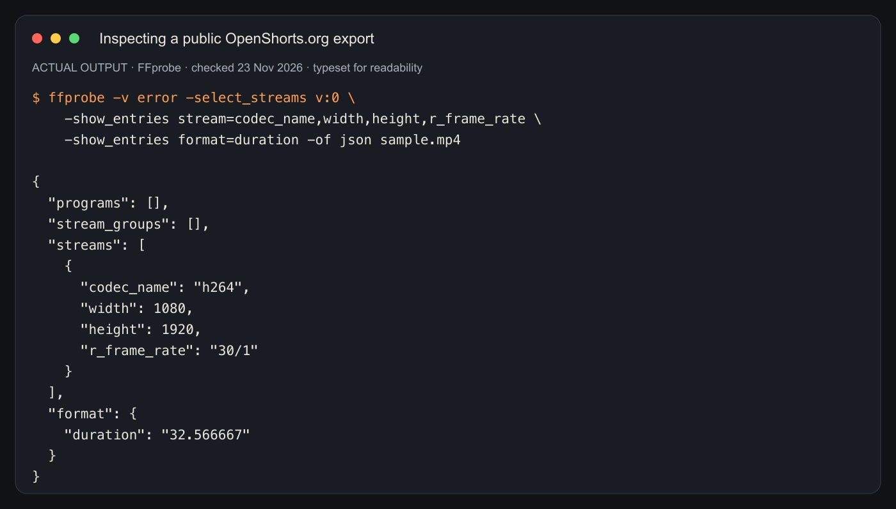
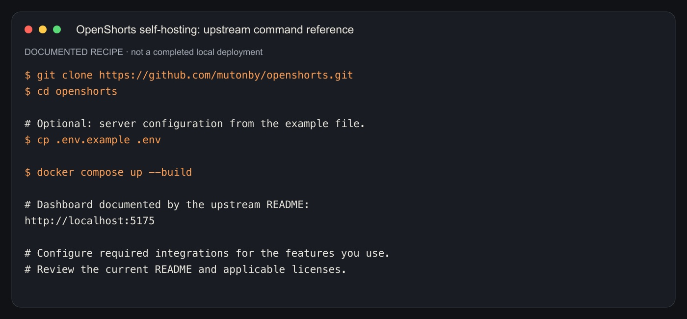
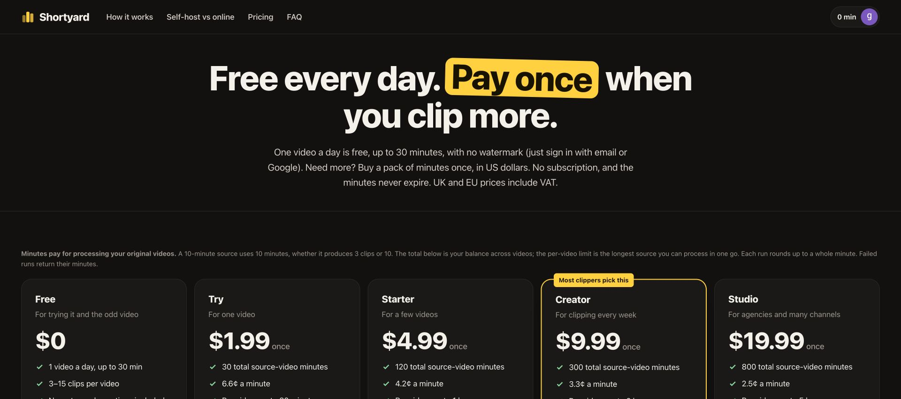

# OpenShorts Review: Self-Host It or Use It Online?

A practical look at setup, output files, pricing, and the limitations worth checking before you process a long video.

OpenShorts sounds like a simple proposition: give it a long video, let AI identify promising moments, and download vertical clips with captions. The decision gets more interesting when you choose where to run it.

You can run the open-source project yourself. You can use its official hosted service. Or you can use an independent service built around the clipping engine, such as Shortyard on OpenShorts.org.

Those are different products and different operating arrangements. The name alone does not tell you which features, limits, or support process you are getting.

**Disclosure:** The Clip Notebook is operated by the team behind OpenShorts.org and Snazo.org. This is a product walkthrough and technical review from the operator, not an independent comparison. We checked the live website, upstream documentation, and an existing public output file on November 23, 2026. We did not run a new self-hosted benchmark for this article.

## First, separate the project from the websites

| Option | What it is | What you manage |
| --- | --- | --- |
| OpenShorts on GitHub | The upstream open-source project at mutonby/openshorts | Installation, dependencies, compute, updates, and any external model services you choose |
| OpenShorts.app | The upstream project's hosted service | Your account and the service's plan limits |
| OpenShorts.org / Shortyard | Our independent browser-based clipping service | Your account, source videos, clip review, and downloads |

[OpenShorts.org](https://openshorts.org/?utm_source=github-pages&utm_medium=outreach&utm_campaign=backlinks) is not the official OpenShorts website and is not affiliated with OpenShorts.app or its authors. Sharing an engine does not mean the hosted interfaces have identical features.

## The online workflow: start with your original file

The Shortyard homepage puts the upload area next to a YouTube URL field. Supported upload formats listed on the page are MP4, MOV, and WebM, with a 4 GB upload limit.

For a first attempt, use a short talking video you own: an interview answer, a podcast segment, or an explanation recorded to camera. Keep the original source file available.



*Shortyard on OpenShorts.org: upload a file or provide a YouTube link. Screenshot captured November 23, 2026.*

Sign in, submit the source, and review the resulting clips on the job page. The intended workflow is candidate selection, vertical reframing, captions, and downloadable MP4 files.

A YouTube link is convenient, but adds another dependency: the server has to fetch the video before it can transcribe or cut anything. A video playing in your browser does not prove that a remote server can download it.

Uploads avoid that particular dependency. They do not guarantee a successful job regardless of file size, format, audio quality, or processing conditions.

## What we checked in a real output file

The site has a public sample section using GTA VI Trailer 2 footage, with the original source credited to Rockstar Games. Those samples demonstrate the site's published output; they are not a new podcast experiment conducted for this review.



*Existing public trailer samples on OpenShorts.org. Source footage: Rockstar Games. These are not podcast benchmark results.*

We downloaded the first sample and inspected it with FFprobe. The file reported H.264 video, a 1080 by 1920 frame, 30 frames per second, and a duration of approximately 32.57 seconds.

```bash
curl -fL https://openshorts.org/samples/gta6-t2-0.mp4 -o sample.mp4
ffprobe -v error -select_streams v:0   -show_entries stream=codec_name,width,height,r_frame_rate   -show_entries format=duration -of json sample.mp4
```



*Actual FFprobe output from the downloaded public sample, typeset for readability. This verifies that file's encoding and dimensions, not the quality of every generated clip.*

Those properties tell you that the export is a vertical video file. They do not establish whether the selected moment is interesting, whether every subtitle is correct, or whether a clip will perform well on a social platform.

For that, watch the output. Check the opening, the payoff, the framing, and the transcript against the original source. Listen once with sound, then watch once muted to judge the captions.

## Self-hosting: what the terminal steps actually involve

The upstream [GitHub README](https://github.com/mutonby/openshorts#readme) documents a Docker-based setup. Its basic getting-started sequence is:

```bash
git clone https://github.com/mutonby/openshorts.git
cd openshorts
# Optional: configure server settings from the example file.
cp .env.example .env
docker compose up --build
```

The documented dashboard address is `http://localhost:5175`. The optional environment file is configuration, not proof that all required model services are ready. Follow the current README for the features you intend to use.



*Command reference based on the upstream README. This is an installation recipe, not a screenshot of a completed deployment.*

The important work begins around those commands: making sure Docker is running, allowing time and storage for dependencies and models, choosing how the AI analysis runs, and keeping the system updated.

The upstream project documents both a Gemini-based path and a local model option using an OpenAI-compatible endpoint. Some visual-analysis features still depend on Gemini or fall back to a simpler behavior when that key is absent. Voice dubbing and social publishing have separate integrations. You do not need every optional integration merely to explore basic clipping.

GPU instructions in the README target NVIDIA hardware. Do not treat a command containing `--gpus all` as a universal acceleration switch for every laptop.

We did not start a local Docker deployment for this review, so there is no measured installation time, CPU-versus-GPU comparison, or local processing-speed claim here.

## Free code and a free hosted allowance mean different things

Self-hosting gives you control over the software and the machine running it. It also makes you responsible for compute, disk space, model configuration, and any metered API services you enable.

Shortyard packages the online clipping path differently. Its current plans are:

| Plan | Price | Total source-video minutes | Maximum source length per run |
| --- | --- | --- | --- |
| Free | $0 | One eligible video per day | 30 minutes |
| Try | $1.99 once | 30 minutes | 30 minutes |
| Starter | $4.99 once | 120 minutes | 60 minutes |
| Creator | $9.99 once | 300 minutes | 120 minutes |
| Studio | $19.99 once | 800 minutes | 300 minutes |

*Checked November 23, 2026. The free allowance requires an account and is subject to regional eligibility, usage controls, and available daily capacity. See the current site before submitting.*



*The pricing page distinguishes a pack's total balance from the maximum source length per run.*

Billing counts the original video duration processed, rounded up per run. A 10-minute, 20-second source uses 11 minutes. Producing more clips from that same run does not multiply the source-minute charge.

Purchased minutes do not expire under the current plan terms. Output retention is separate: the site lists seven days for free clips and 30 days for paid clips. Download the files you want to keep.

## The limitations that matter in practice

**Download reliability is a real constraint.** Our production checks have included YouTube download failures. A fallback route can help, but it is not a promise that every public URL will work. Paid download rescue and the free processing path also have different handling; do not assume every job gets the same recovery process.

**Automatic selection still needs an editor.** A complete sentence can be a weak clip. A dramatic quote can misrepresent the discussion when its qualification is missing. Review meaning as well as pacing.

**The browser service is a clipping workflow, not the full upstream dashboard.** Do not assume upstream features such as every dubbing, publishing, automation, or model-integration option are available on OpenShorts.org.

**The core license is not the license for every directory.** The upstream README identifies the core application as MIT-licensed and gives its `cloud/` directory a separate commercial license. Read the applicable license before reusing hosted-service components.

## Which route would we choose?

Self-hosting is worth considering when you already manage Docker, want to customize the pipeline, or need control over the processing environment. If keeping footage local is the goal, also inspect whether any configured model service receives transcripts or frames.

The browser route is a useful starting point when you want to evaluate candidate clips without maintaining a local installation. Try a short original upload, check the captions and framing, and download a result before committing a long recording or buying a larger pack.

You can [try Shortyard on OpenShorts.org](https://openshorts.org/?utm_source=github-pages&utm_medium=outreach&utm_campaign=backlinks) or read the [upstream OpenShorts documentation](https://github.com/mutonby/openshorts#readme) to explore self-hosting. Choose based on the workflow you want to own—and judge the final clips yourself.
