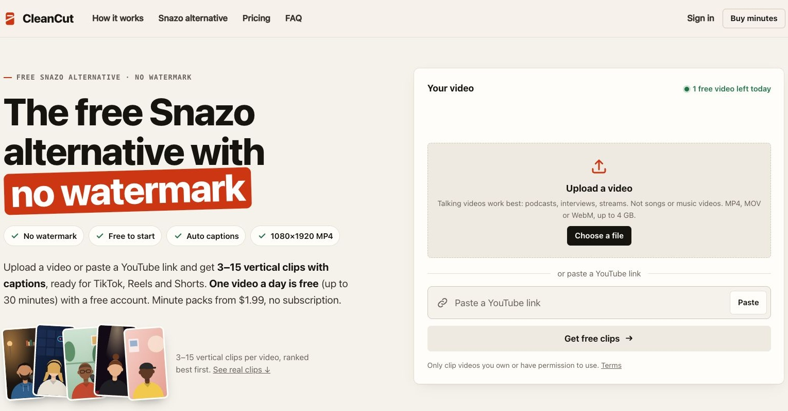
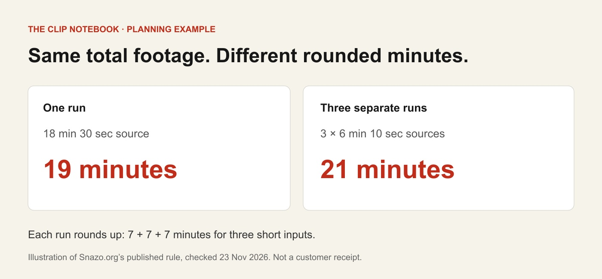
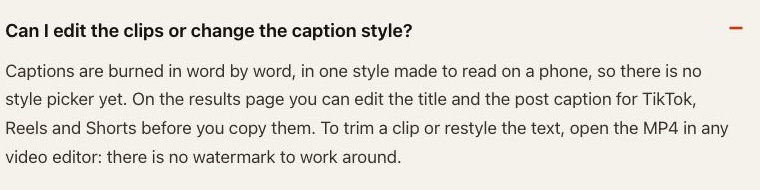

# Snazo.org Review: A Podcaster’s First-Upload Checklist

What to prepare, what the browser tool handles, and what still needs your judgment before a clip is ready to post.

You have finished recording. The episode is exported, the microphones are packed away, and the next job is to find something short enough to share.

Before sending the entire recording to an AI clipper, it helps to decide what a useful first result would look like. Perhaps it is one answer that explains your guest’s experience. Perhaps it is a short exchange that makes someone want to hear the rest. That choice gives you a way to judge the tool beyond counting how many files it returns.

This review looks at CleanCut on [Snazo.org](https://snazo.org/?utm_source=github-pages&utm_medium=outreach&utm_campaign=backlinks) from that starting point: preparing a first upload, understanding the processing allowance, and deciding what to do with the result.

**About this review:** Our team operates CleanCut on Snazo.org. It is a separate service from Snazo.app and has no affiliation with it. We inspected the live interface, pricing, and editing FAQ on November 23, 2026. The examples below are planning examples; we have not presented a newly generated podcast as a completed test.

## Choose one question the clip should answer

A whole episode can contain several competing topics. A first upload is easier to evaluate if you already know the part you care about.

Write down one question before opening the tool. For an interview with a local business owner, it might be: “What changed after their first unsuccessful launch?” For an educational podcast, it might be: “Which mistake should a beginner avoid?”

Those are examples, not prompts that CleanCut necessarily accepts as processing controls. Their purpose is to give you an editorial target when reviewing its selections.

Choose source footage with audible conversation and enough surrounding context to understand the answer. Avoid starting your evaluation with a music montage, several people speaking over one another, or a long section of silence. The upload interface itself says talking videos work best and specifically distinguishes them from songs and music videos.

## Prepare the source you can actually submit

CleanCut’s browser interface accepts a file or a YouTube link. The upload panel lists MP4, MOV, and WebM, with a maximum file size of 4 GB.

If you recorded the podcast, your original export is a sensible starting point. It gives you control over the version, audio mix, and file you are sending. Check that the file opens locally, contains the intended audio track, and includes the end of the conversation.

*Snazo.org’s upload interface, captured for this review. The page recommends talking videos and lists supported input formats.*

File size and duration are separate checks. A short, high-bitrate recording can exceed the upload limit; a small compressed file can still contain a long episode. Inspect both before choosing an allowance or paid pack.

If you shorten a recording before uploading, keep the introduction needed to identify the subject of the conversation. The aim is to remove irrelevant material, not to make an answer incomprehensible before the clipper sees it.

## Make the first run small enough to learn from

The current free offer is one eligible video per day, up to 30 minutes, with a free account. Eligibility also depends on region, usage controls, and available daily processing capacity. Seeing a free option on the pricing page does not guarantee every account can start a free job at any moment.

For an initial evaluation, a short section with one speaker change and a clear answer can be more informative than an entire show. You can inspect whether the tool follows the right person and whether the extracted answer makes sense, without committing a large source file.

The purpose is to find out whether the output fits your material. An interview with steady framing and clear speech is a different challenge from a remote call with interruptions and shared screens.

## Read the minute balance as a source-video budget

If you decide to pay, CleanCut currently sells one-time minute packs rather than a recurring subscription. The smallest listed paid option is $1.99 for 30 total source-video minutes. Those minutes describe the recording being processed, not the combined length of the short clips you download.

The site rounds each run up to a whole minute. That produces a small but useful planning distinction:

| Illustrative submission plan | Source duration | Minutes used under the published rule |
| --- | --- | --- |
| One recording | 18 minutes 30 seconds | 19 minutes |
| Three separate recordings | 6 minutes 10 seconds each | 7 + 7 + 7 = 21 minutes |

*Worked example based on the published per-run rounding rule. It is not a receipt or a record of actual customer charges.*

This does not mean you should combine unrelated recordings merely to save two minutes. A coherent source is easier to evaluate, and a larger batch can leave you with more irrelevant candidates to review.

Also check the longest input allowed in one run. For example, the $4.99 Starter pack currently includes 120 total minutes, but its per-video maximum is 60 minutes. A 90-minute episode does not fit that single-run limit just because its length is below your total balance. Prices and limits should be rechecked on the [current pricing page](https://snazo.org/pricing/?utm_source=github-pages&utm_medium=outreach&utm_campaign=backlinks).

## Decide whether the built-in captions fit your publishing style

This is a useful question to answer before processing a batch for a client.

CleanCut’s FAQ says captions are burned into the video in one word-by-word style. There is no caption-style picker yet. The results page allows editing the clip title and the accompanying post caption, which is different from changing the visible subtitles inside the MP4.

*The live editing FAQ distinguishes editable titles and post copy from burned-in video captions.*

If you need a specific typeface, exact line breaks, or a client’s visual identity, check a sample against those requirements first. Opening the exported MP4 in another editor lets you trim the clip or add other elements. It does not turn burned-in subtitle pixels back into a separate editable text layer.

For a wrong name or a missing negative, an extra overlay may hide the issue, but that is a repair decision. Do not assume a text field beside the clip will correct the words already rendered into the video.

This makes CleanCut most appealing when its existing caption treatment suits the job. A detailed subtitle-design workflow may require an additional editor or a different export path.

## Review one clip as if the viewer has never heard your show

Pick a candidate and play it without the rest of the episode. Listen for unexplained references: “that approach,” “the second option,” or a person introduced ten minutes earlier.

Then check the final sentence. A clip can begin with an interesting question and stop before the explanation becomes useful. Keep enough of the answer to reward the viewer’s attention.

For a two-person conversation, inspect each speaker change. Check whether the crop follows the person making the point and whether gestures, a demonstration, or a shared screen have disappeared outside the vertical frame.

Finally, compare the spoken words with the visible captions. Names, amounts, dates, and the word “not” deserve a separate pass. These are editorial checks, not claims about a measured error rate in this review.

## Have a next step ready when a YouTube link fails

A public video can play in a normal browser while a server-side download is refused. That interruption happens before useful transcription and clipping can begin.

If the recording is yours, return to the original file and use the upload route. Repeatedly submitting the same blocked URL is not a dependable recovery strategy.

The site describes returned minutes for failed paid runs. When inspecting a failure, check the task result and the balance rather than interpreting a preview, queue entry, or download attempt as a finished clip. Uploading removes the remote-YouTube-fetch step, but other input or processing errors remain possible.

## Keep the export, not just its link

Under the current published retention terms, free clips remain available for seven days and paid clips for 30 days. Purchased minutes not expiring does not mean generated videos are stored forever.

Download the chosen clips, play the saved files, and keep the original recording alongside them. For a podcast workflow, a simple folder can contain the source name, selected time range, final export, and the title used for publishing. That makes later corrections and re-edits easier.

## Our recommendation for a first attempt

CleanCut offers a focused starting point for a podcaster who wants candidate clips in the browser and does not need a detailed subtitle-design interface. The tradeoff is that you still own selection, meaning, finishing, and file retention.

Start with one manageable recording and a written question you want the clip to answer. Check that your account and input are eligible, review a completed result, and save a playable export before expanding the workflow.

[Open CleanCut on Snazo.org](https://snazo.org/?utm_source=github-pages&utm_medium=outreach&utm_campaign=backlinks) when you have that source ready. The useful outcome is a clip that communicates your point clearly, with a process you can repeat for the next episode.
